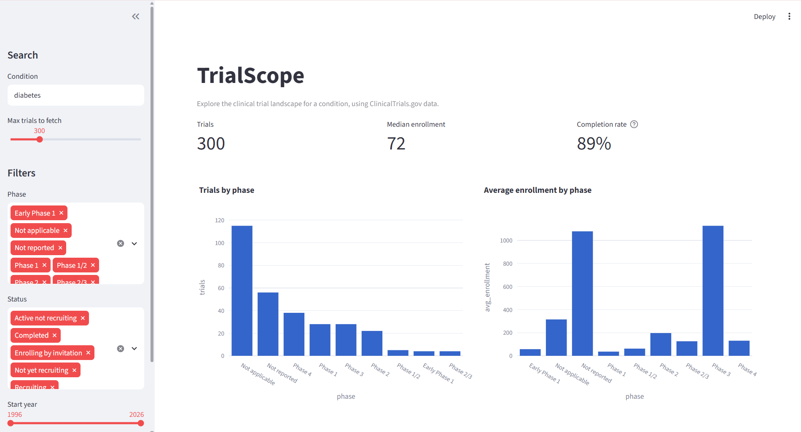
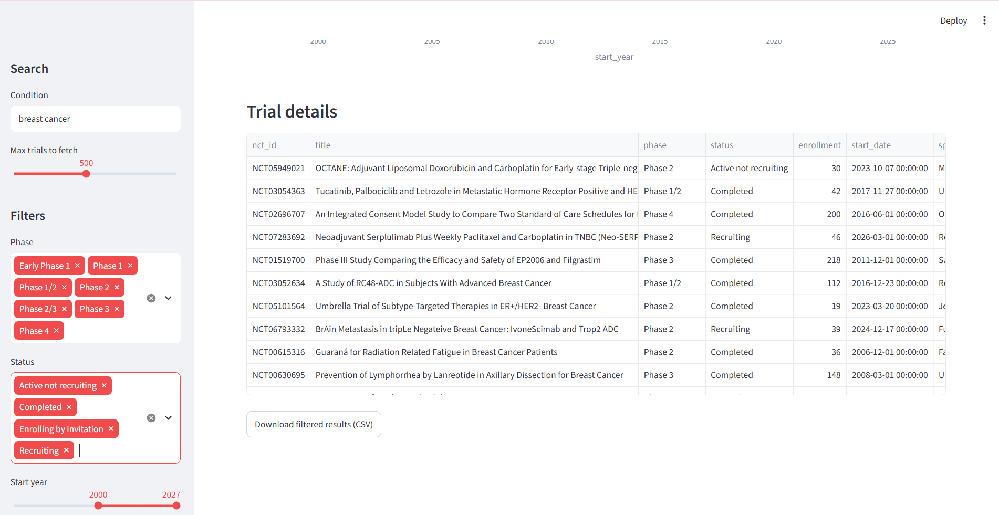
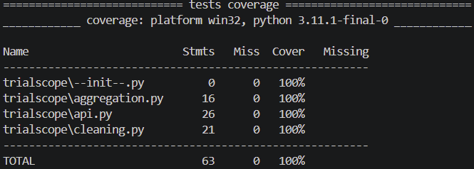

# TrialScope


An interactive dashboard for exploring the clinical trial landscape for any condition, built with Python and the public ClinicalTrials.gov API.

**Live demo:** [TrialScope](https://trialscope-mybydm2qrqkiretv9ha4jl.streamlit.app/)



## Why this exists

Researchers and grant writers often need a quick sense of what trials already exist for a disease: how many, which phases, how big, and how often they finish. ClinicalTrials.gov's search page isn't built for summary numbers or comparing across conditions, so TrialScope pulls the data and summarizes it for you.

## Features

- Search any condition and pull up to 1,000 trials
- Filter by phase, status, and start year
- Headline stats: trial count, median enrollment, completion rate
- Charts for trials by phase, average enrollment by phase, and trials started per year
- Download the filtered results as CSV



## Run it yourself

```bash
git clone https://github.com/KaitlynChihaoui/trialscope.git
cd trialscope
python -m venv venv
venv\Scripts\activate        # Mac/Linux: source venv/bin/activate
pip install -r requirements.txt
streamlit run app.py
```

## Tests

```bash
pytest --cov=trialscope --cov-report=term-missing
```

The test suite covers the API wrapper (with mocked responses, so no internet is needed), the data-cleaning functions, and the aggregation logic. Current coverage of the non-UI code: **100%**. Tests run automatically on every push through GitHub Actions.



## Project structure

```
trialscope/      data fetching, cleaning, and aggregation code
tests/           pytest tests and a saved sample of real API data
app.py           Streamlit dashboard
```

## Design notes

- Phase labels "Not applicable" (observational and behavioral studies) and "Not reported" (field left blank) are kept separate, since they mean different things.
- Missing enrollment stays blank rather than becoming 0, so averages aren't dragged down.
- Completion rate only counts finished trials (completed, terminated, withdrawn), so ongoing trials don't lower it.

## Data

Trial data comes from the [ClinicalTrials.gov API](https://clinicaltrials.gov/data-api/api). It's public and contains no patient data.

## Acknowledgments

Built for a graduate Python course at UNC. I used GitHub Copilot for code completion and boilerplate. All suggested code was reviewed and tested before use, in line with UNC's AI-use policy.